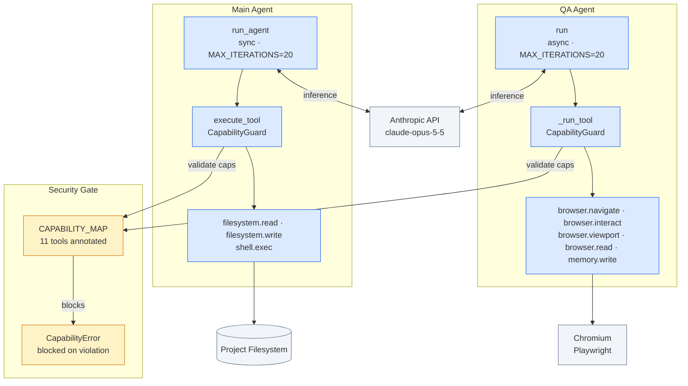

# Agent Topology — brownfield

## Overview

Two independent single-file Python agents, each a self-contained tool-calling loop backed by
`claude-opus-5-5`. Neither agent orchestrates the other. This PoC adds a shared
`CAPABILITY_MAP` security layer to both agents' executors and brings the QA agent's iteration
guard in line with the main agent.

## Agent Topology Diagram

## Agent Profiles

### Agent 1 — `agentic_app.py`

| Property | Value |
|----------|-------|
| Entry point | `run_agent(user_task: str) → str` |
| Loop style | Synchronous (`Anthropic` client) |
| Iteration cap | `MAX_ITERATIONS = 20` (pre-existing) |
| Model | `claude-opus-5-5`, adaptive thinking |
| Tool count | 5 |
| Capability classes | `filesystem.read`, `filesystem.write`, `shell.exec` |
| Executor | `execute_tool(name, inputs) → str` at line 142 |
| Safety boundary | `run_command` keyword blocklist (pre-existing; safelist deferred) |

### Agent 2 — `agentic_tester.py`

| Property | Value |
|----------|-------|
| Entry point | `run(html_path: str) → None` (async) |
| Loop style | Asynchronous (`AsyncAnthropic` client + `asyncio`) |
| Iteration cap | `MAX_ITERATIONS = 20` (added by this PoC) |
| Model | `claude-opus-5-5`, adaptive thinking |
| Tool count | 6 |
| Capability classes | `browser.navigate`, `browser.interact`, `browser.viewport`, `browser.read`, `memory.write` |
| Executor | `_run_tool(name, inputs) → str` (async) at line 150 |
| Browser state | Module-level `_browser` / `_page` globals (isolation deferred) |

## Capability Map

| Tool | Agent | Allowed Capabilities |
|------|-------|---------------------|
| `read_file` | Main | `filesystem.read` |
| `list_files` | Main | `filesystem.read` |
| `run_command` | Main | `shell.exec` |
| `write_file` | Main | `filesystem.write` |
| `search_in_file` | Main | `filesystem.read` |
| `open_page` | QA | `browser.navigate` |
| `click_button` | QA | `browser.interact` |
| `fill_and_submit` | QA | `browser.interact`, `browser.submit` |
| `resize_viewport` | QA | `browser.viewport` |
| `get_computed_style` | QA | `browser.read` |
| `record_result` | QA | `memory.write` |

## Deferred Agent Concerns

The following concerns were identified during the discuss phase but are out of PoC scope:

| Concern | Location | Reason Deferred |
|---------|----------|----------------|
| `run_command` safelist | `agentic_app.py:172` | Requires safelist definition + user approval of allowed commands |
| `check_env()` wiring | Both agents | Incremental; not a functional blocker for capability auth |
| `REQUIRED_ENV` hardening | `config/env_check.py` | Same as above |
| Browser state isolation | `agentic_tester.py:27–29` | Requires refactor of module-level globals; out of PoC scope |

## Provenance

| Section | Origin | Source |
|---------|--------|--------|
| Overview | Authored | `.aah/codebase-intel/codebase-learning.md §3`, `decision-registry.yaml → tester-iteration-cap` |
| Agent Topology Diagram | Authored | `agentic_app.py:30–138`, `agentic_tester.py:32–146`, `decision-registry.yaml → auth-outbound-approach` |
| Agent Profiles | Authored | `.aah/codebase-intel/codebase-learning.md §7`, `agentic_app.py:30–34`, `agentic_tester.py:27–30` |
| Capability Map | Authored | `agentic_app.py:37–138`, `agentic_tester.py:32–146`, `discuss-prd.md §Solution` |
| Deferred Agent Concerns | Inherited | `discuss-prd.md §Deferred`, `.aah/codebase-intel/codebase-learning.md §11` |
