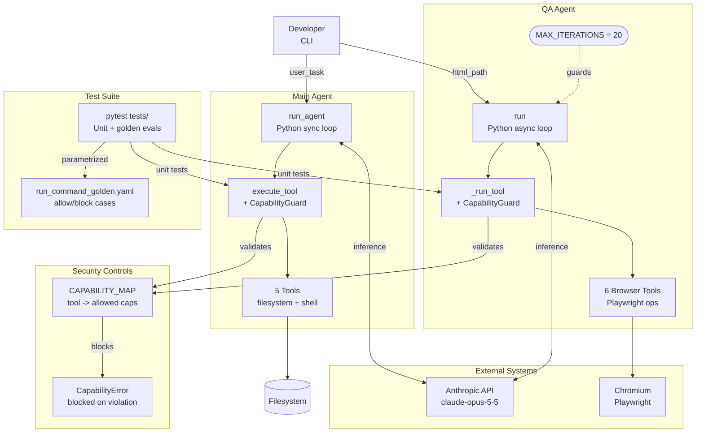

# Architecture Overview — brownfield

## Summary

The brownfield project is a local, on-premises Python CLI application consisting of two independent
agentic loops: a filesystem/shell coding assistant (`agentic_app.py`) and a Playwright browser QA
agent (`agentic_tester.py`). This PoC security hardening pass adds capability-scoped authentication
to all 11 tool calls, an iteration cap to the QA agent, and a pytest unit-test suite with a golden
evaluation set for `run_command` safety decisions.

## Architecture Diagram

## Layer Summary

| Layer | Purpose | Key Components |
|-------|---------|----------------|
| External Systems | Inference provider + browser runtime | Anthropic API, Playwright Chromium |
| Main Agent | Filesystem + shell coding assistant | `agentic_app.py:run_agent`, `execute_tool` |
| QA Agent | Headless browser behavior verification | `agentic_tester.py:run`, `_run_tool` |
| Security Controls | Capability-scoped auth gate (new) | `CAPABILITY_MAP`, `CapabilityError` |
| Test Suite | Automated regression + golden evals (new) | `tests/`, `run_command_golden.yaml` |

## Technology Decisions

| Concern | Decision | Rationale |
|---------|----------|-----------|
| Auth model | Capability-scoped per tool | Deterministic skeleton control; no prompt-injection bypass |
| Test framework | pytest + pytest-asyncio | Standard Python; no model calls needed to run suite |
| Iteration cap | `MAX_ITERATIONS = 20` (matches main agent) | Closes runaway-loop gap; consistent policy across both agents |
| Deployment | Local CLI, on-prem | No server, no container, no cloud dependency |

## Constraints

- No full rewrite — changes are additive patches to existing files
- Deferred: `run_command` safelist, `check_env()` wiring, `REQUIRED_ENV` hardening, browser state isolation
- Cloud: none (`cloud-vs-local = local`)
- Persistence: none (`data-storage-present = no`)
- UI: none (`custom-ui-required = no`)

## Provenance

| Section | Origin | Source |
|---------|--------|--------|
| Summary | Authored | `decision-registry.yaml → cloud-vs-local`, `decision-registry.yaml → custom-ui-required` |
| Architecture Diagram | Authored | `agentic_app.py:142`, `agentic_tester.py:150`, `decision-registry.yaml → auth-outbound-approach` |
| Layer Summary | Authored | `.aah/codebase-intel/codebase-learning.md §3` |
| Technology Decisions | Authored | `decision-registry.yaml → auth-outbound-approach`, `decision-registry.yaml → eval-suite-scope`, `decision-registry.yaml → tester-iteration-cap` |
| Constraints | Inherited | `discuss-prd.md §Constraints` |
