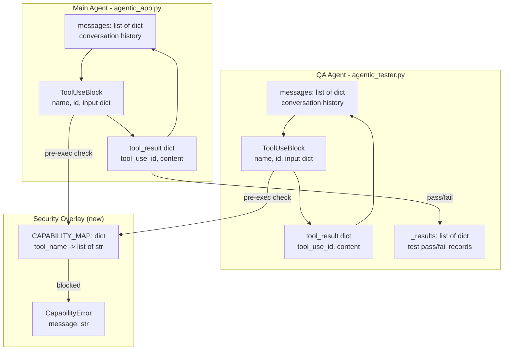

# Data Model — brownfield

## Overview

The application is entirely stateless and in-memory per run — there are no persistent data stores.
All runtime data is scoped to a single invocation of `run_agent` or `run`, discarded on exit.
This document describes the in-flight data structures that flow through the two agents.

## In-Memory Data Structures

## Key Data Structures

| Structure | Location | Fields | Lifecycle |
|-----------|----------|--------|-----------|
| `messages` | `run_agent` / `run` local var | `role`, `content` (list of blocks) | In-memory per invocation |
| `ToolUseBlock` | Anthropic SDK response | `type=tool_use`, `id`, `name`, `input` | Transient — consumed per loop iteration |
| `tool_result` dict | Loop body | `type=tool_result`, `tool_use_id`, `content` | Transient — appended back to `messages` |
| `CAPABILITY_MAP` | Module-level constant | `tool_name: str → caps: list[str]` | Static — defined at module load |
| `CapabilityError` | Raised by executor | `message: str` | Raised + caught within executor; returned as `tool_result` string |
| `_results` | Module global in tester | `test_id`, `test_name`, `passed`, `expected`, `actual` | Per run; printed at end of `run()` |
| Golden set entry | `tests/golden/run_command_golden.yaml` | `command`, `expected_outcome` (allow/block), `rationale` | Static YAML; no runtime mutation |

## Data Flow Notes

- **No persistence**: `messages` and `_results` are reset each time `run_agent()` or `run()` is called.
- **Capability check path**: a `ToolUseBlock.name` is looked up in `CAPABILITY_MAP`; if the tool name is absent or its declared capabilities do not cover the requested operation, a `CapabilityError` is raised and its message is returned as the `tool_result` content (the loop continues).
- **Golden set**: `run_command_golden.yaml` is read-only at test time; it is never written by either agent.
- **`_results` global**: the module-level `_results` list in `agentic_tester.py` is intentionally not reset between successive calls to `run()` within the same process — this is a known pre-existing limitation (not in PoC scope to fix).

## Provenance

| Section | Origin | Source |
|---------|--------|--------|
| Overview | Authored | `.aah/codebase-intel/codebase-learning.md §5` |
| In-Memory Data Structures diagram | Authored | `agentic_app.py:241`, `agentic_tester.py:253`, `decision-registry.yaml → auth-outbound-approach` |
| Key Data Structures table | Authored | `agentic_app.py:142–218`, `agentic_tester.py:150–240`, `decision-registry.yaml → eval-suite-scope` |
| Data Flow Notes | Authored | `.aah/codebase-intel/codebase-learning.md §5`, `.aah/codebase-intel/codebase-learning.md §11` |
