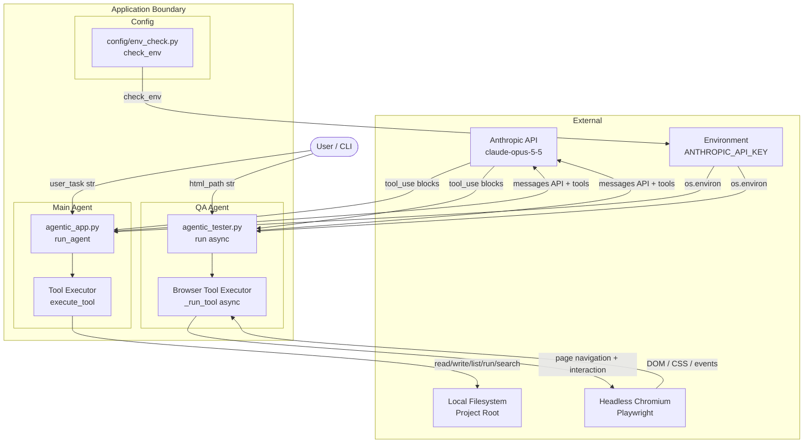

# System Architecture

## Overview

A two-agent Python application: one general-purpose AI coding assistant that operates on the local filesystem via tool-calling, and one autonomous QA agent that drives a headless browser to test a web application against a behavior catalog. Both agents use claude-opus-5-5 with adaptive thinking.

## Architecture Diagram

## Layer Summary

| Layer | Purpose | Key Components |
|-------|---------|----------------|
| External | Third-party services and OS resources | Anthropic API, Playwright Chromium, filesystem, env vars |
| Main Agent | Filesystem + shell task execution via LLM | `agentic_app.py`, `execute_tool` |
| QA Agent | Browser-based behavioral testing via LLM | `agentic_tester.py`, `_run_tool` |
| Config | Startup environment validation | `config/env_check.py` |

## External Integrations

- **Anthropic API** (`anthropic.Anthropic` / `anthropic.AsyncAnthropic`): both agents call `messages.create` with `tool_use` and `adaptive` thinking enabled. API key read from `ANTHROPIC_API_KEY`.
- **Playwright Chromium**: `agentic_tester.py` launches `chromium` headless via `async_playwright`. Browser state is shared across the entire test run via module-level globals `_browser` and `_page`.
- **Local filesystem**: `agentic_app.py` tools operate within `PROJECT_ROOT = Path(__file__).parent`.
