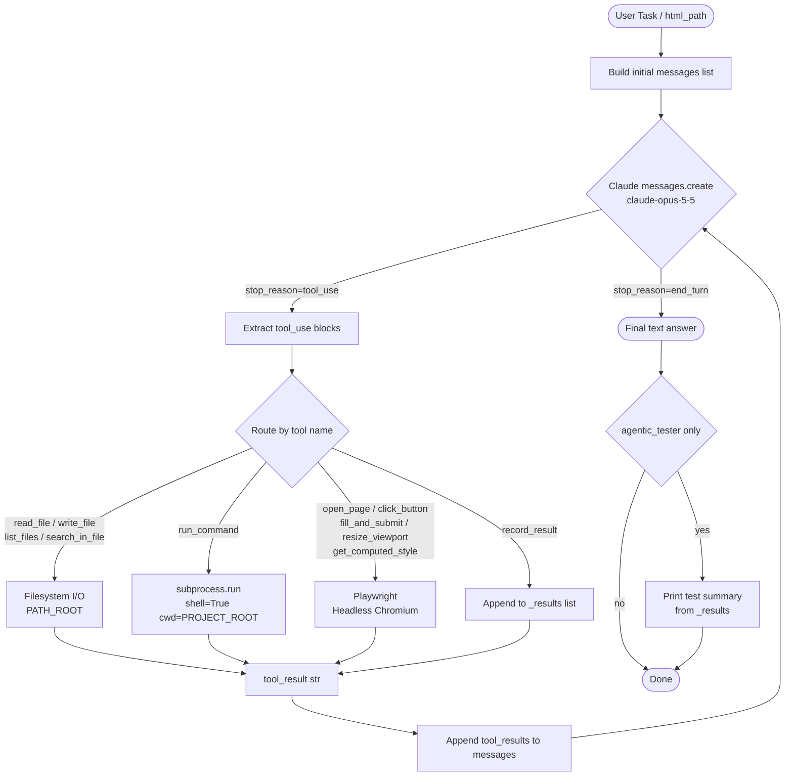

# Data Flow

## Overview

Both agents follow the same agentic loop pattern: user input → Claude inference → tool execution → result back to Claude → repeat until `stop_reason != "tool_use"`. No queues, no databases, no async pipelines outside the browser test agent's Playwright I/O.

## Data Flow Diagram

## Data Pipelines

| Pipeline | Source | Processing | Destination |
|----------|--------|-----------|-------------|
| Main agent tool loop | User task string | Claude inference + tool dispatch (up to 20 iterations) | Final text printed to stdout; files written to PROJECT_ROOT |
| QA agent browser loop | HTML file path | Claude inference + Playwright tool dispatch | Test results accumulated in `_results`; summary printed to stdout |
| Environment check | `.env` file (optional) | Line-by-line KEY=value parse; os.environ patched | `os.environ` (non-overriding) |

## Integration Points

- **Inbound**: user-supplied task string (`run_agent`) or HTML file path (`run`); optional `.env` file loaded at startup via `config/env_check.py`.
- **Outbound**: Anthropic API (HTTPS to `api.anthropic.com`); local filesystem writes via `write_file` tool; Playwright opens local `file:///` URLs in Chromium.
- **Safety boundary**: `run_command` in `agentic_app.py` blocks a hardcoded list of destructive keywords (`rm `, `del `, `format `, `mkfs`, `sudo`, `shutdown`, `:(){`) before calling `subprocess.run`.
