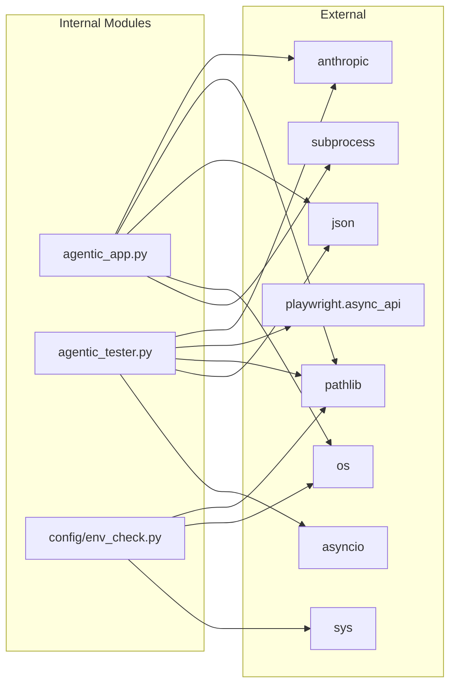

# Module Dependencies

## Overview

Three independent modules; no internal cross-imports. `config/env_check.py` exists as a standalone helper that neither agent imports yet — it is wired by convention (call `check_env()` at the entrypoint), not by import.

## Dependency Graph

## Coupling Analysis

| Module | Fan-In | Fan-Out | Assessment |
|--------|--------|---------|------------|
| `agentic_app.py` | 0 (entry point) | 5 | Independent; safe to modify |
| `agentic_tester.py` | 0 (entry point) | 5 | Independent; safe to modify |
| `config/env_check.py` | 0 (not yet imported) | 3 | Standalone utility; wired by convention |

## Circular Dependencies

None detected.
